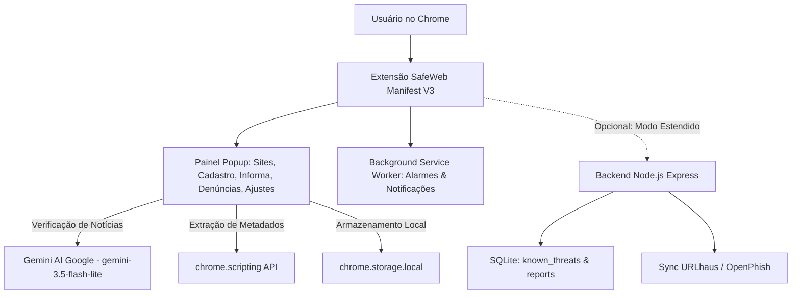

# SafeWeb 🛡️ (v2.0)

> **Projeto Acadêmico:** Extensão para Google Chrome (Manifest V3) com IA Gemini e Backend Auxiliar em Node.js  
> **Desenvolvido por:** Iury & Equipe  
> **Objetivo:** Segurança proativa na navegação web, monitoramento contínuo de disponibilidade (Uptime), combate à desinformação com inteligência artificial e proteção contra ameaças digitais.

---

## 📌 Sumário
- [Visão Geral](#-visão-geral)
- [Principais Funcionalidades](#-principais-funcionalidades)
- [Módulo SafeWeb Informa (IA & Fake News)](#-módulo-safeweb-informa-ia--fake-news)
- [Módulo de Monitoramento & Uptime](#-módulo-de-monitoramento--uptime)
- [Módulo de Segurança Heurística & Threat Intelligence](#-módulo-de-segurança-heurística--threat-intelligence)
- [Base Comunitária de Denúncias](#-base-comunitária-de-denúncias)
- [Arquitetura do Sistema](#-arquitetura-do-sistema)
- [Estrutura do Repositório](#-estrutura-do-repositório)
- [Como Instalar e Usar a Extensão](#-como-instalar-e-usar-a-extensão)
- [Configuração da Chave da Gemini API](#-configuração-da-chave-da-gemini-api)
- [Como Executar o Backend (Opcional)](#-como-executar-o-backend-opcional)
- [Segurança & Gestão de Segredos](#-segurança--gestão-de-segredos)
- [APIs do Chrome Manifest V3 Utilizadas](#-apis-do-chrome-manifest-v3-utilizadas)
- [Licença](#-licença)

---

## 🌐 Visão Geral

O **SafeWeb** é uma solução completa e multiplataforma desenvolvida para atender aos desafios contemporâneos da web:
1. **Monitoramento de Serviços:** Vigilância de disponibilidade (Uptime) de sites e sistemas, detectando quedas de conexão, latência elevada e erros HTTP com notificações no navegador.
2. **Prevenção de Golpes & Phishing:** Detecção avançada de typosquatting, ataques homográficos (Punycode IDN), engenharia social de bancos e marcas brasileiras, entropia de Shannon e verificação contra bases de inteligência cibernética (**URLhaus** e **OpenPhish**).
3. **Combate à Desinformação (SafeWeb Informa):** Verificação inteligente de notícias, desinformação e caça-cliques com apoio da **Gemini API do Google (gemini-3.5-flash-lite)** e checagem cruzada com agências de fact-checking brasileiras.
4. **Colaboração Comunitária:** Canal para que usuários relatem sites maliciosos, gerando inteligência coletiva de proteção.

---

## ⚡ Principais Funcionalidades

- 🧠 **Auditoria com Gemini AI Oficial:** Avaliação contextualizada de textos e matérias jornalísticas em segundos, sem categorizações genéricas.
- 🎯 **Captura Inteligente da Aba Ativa:** Preenchimento automático com um clique da URL, título e corpo textual extraído diretamente da página via `chrome.scripting`.
- 🔍 **Detecção de Falsificação de Marcas (Typosquatting/Combosquatting):** Identificação de imitações de Nubank, Itaú, Bradesco, Caixa, Mercado Livre, Gov.br, Google, Apple, etc., através do algoritmo de distância Levenshtein.
- 🚨 **Sinais de Alerta & Clickbait:** Análise de tom alarmista, letras maiúsculas exageradas, gatilhos de urgência de compartilhamento e TLDs de alto risco (`.xyz`, `.top`, `.site`, etc.).
- 🛡️ **Threat Intelligence Integrada:** Suporte a blocklists abertas de malware e phishing mantidas por URLhaus e OpenPhish.
- ⚙️ **Painel de Ajustes Completo:** Configuração de intervalos de alarme (1 a 30 min), sensibilidade heurística, URL do backend e salvamento seguro da chave Gemini.
- 📊 **Auditoria & Exportação Acadêmica:** Exportação completa de logs de monitoramento e histórico de verificações em formatos **JSON** e **CSV**.

---

## 📰 Módulo SafeWeb Informa (IA & Fake News)

O **SafeWeb Informa** foi planejado para apoiar o letramento digital e o pensamento crítico do leitor:

### Classificações do Sistema:
- 🟢 **FONTE CONFIÁVEL:** Veículos de imprensa com expediente auditável, conselho editorial reconhecido e compromisso jornalístico.
- 🟡 **ALERTA DE SENSACIONALISMO / PRECISA DE MAIS VERIFICAÇÃO:** Conteúdos apelativos, manchetes caça-cliques, blogs anônimos ou informações sem embasamento suficiente.
- 🔴 **ALERTA DE FAKE NEWS / ALEGAÇÃO DESMENTIDA:** Boatos identificados, curas milagrosas falsas, golpes financeiros ou teorias conspiratórias refutadas por checagens oficiais.

### Recursos do Informa:
- **Resumo Explicativo da IA:** Frase clara, direta e acessível sintetizando o porquê daquele veredito.
- **Checagem Cruzada em 1 Clique:** Atalhos imediatos de busca nas principais agências de checagem do Brasil: *Fato ou Fake (G1)*, *Agência Lupa*, *Aos Fatos* e *UOL Confere*.
- **Casos de Demonstração Pré-Carregados:** Botão com exemplos reais para testes em apresentações e salas de aula.

---

## 📈 Módulo de Monitoramento & Uptime

- Cálculo dinâmico de taxa de disponibilidade (**% Uptime**).
- Resumo visual de sites **Online**, **Offline** e **Total**.
- Alertas nativos no sistema operacional em caso de instabilidade ou restabelecimento do serviço.
- Filtros rápidos por status e barra de pesquisa em tempo real.

---

## 🏛️ Arquitetura do Sistema



- **Modo Autônomo (100% no Cliente):** A extensão funciona de forma completa e independente, executando heurísticas locais e chamando a API do Gemini diretamente pelo navegador.
- **Modo Estendido (Com Backend):** O servidor Node.js adiciona persistência em banco relacional SQLite e sincronização com listas de ameaças de inteligência cibernética.

---

## 📂 Estrutura do Repositório

```text
SAfev2/
├── extension/                      # Extensão Google Chrome (Manifest V3)
│   ├── manifest.json               # Configurações, permissões e metadados MV3
│   ├── popup/                      # Interface gráfica do usuário
│   │   ├── popup.html              # Estrutura HTML modular (6 abas ativas)
│   │   ├── popup.css               # Estilos modernos, responsivos e acessíveis
│   │   └── popup.js                # Controlador principal de eventos e renderização
│   ├── background/
│   │   └── service-worker.js       # Tarefas em segundo plano e monitoramento periódico
│   ├── services/
│   │   ├── gemini-analyzer.js      # Integração direta com Google Gemini API
│   │   ├── news-analyzer.js        # Motor de desinformação (IA + Heurística local)
│   │   ├── security-analyzer.js    # Motor de análise de URLs, Levenshtein e risco
│   │   ├── api-client.js           # Cliente HTTP com o backend Node.js
│   │   ├── secrets.example.js      # Modelo de segredos (versionado no Git)
│   │   └── secrets.js              # Segredos locais (protegido no .gitignore)
│   ├── storage/
│   │   ├── storage-manager.js      # Wrapper sobre chrome.storage.local
│   │   ├── sites-storage.js        # Persistência de sites monitorados
│   │   └── history-storage.js      # Persistência de histórico de eventos e notícias
│   ├── styles/
│   │   └── common.css              # Variáveis CSS, layout e tipografia
│   └── icons/                      # Ícones em resolução 16px, 48px e 128px
│
├── backend/                        # Backend Auxiliar em Node.js (Express + SQLite)
│   ├── src/
│   │   ├── server.js               # Servidor HTTP Express
│   │   ├── database.js             # Conexão SQLite e tabelas de ameaças/denúncias
│   │   ├── routes/                 # Rotas de sites, segurança, notícias e relatórios
│   │   └── services/               # Workers de monitoramento e Threat Intelligence
│   ├── package.json
│   └── .env.example
│
├── Apresentacao_SafeWeb.pdf        # Documento completo formatado para apresentação
├── APRESENTACAO_SAFEWEB.md         # Roteiro de slides detalhado para PowerPoint
└── README.md                       # Documentação técnica oficial
```

---

## 🚀 Como Instalar e Usar a Extensão

1. Abra o **Google Chrome** (ou navegadores baseados em Chromium como Brave, Edge ou Opera).
2. Acesse `chrome://extensions` na barra de endereços.
3. No canto superior direito, ative o interruptor **Modo do desenvolvedor** (*Developer mode*).
4. Clique no botão **Carregar sem compactação** (*Load unpacked*).
5. Selecione a pasta `extension/` deste projeto:
   ```text
   C:\Users\iury\Documents\Faculdade\SAfev2\extension
   ```
6. O ícone do **SafeWeb** será fixado na barra de ferramentas. Clique nele para abrir a extensão!

---

## 🔑 Configuração da Chave da Gemini API

Para habilitar as respostas inteligentes do Google Gemini no módulo SafeWeb Informa:

1. Obtenha uma chave gratuita no [Google AI Studio](https://aistudio.google.com/apikey).
2. Abra a extensão no navegador e clique na aba **Ajustes** (ícone de engrenagem).
3. No campo **Chave de API do Gemini (Google AI)**, cole sua chave.
4. Clique em **Salvar Ajustes**.

> 🔒 **Privacidade Garantida:** A chave digitada na aba de Ajustes é armazenada exclusivamente no armazenamento local criptografado do seu próprio navegador (`chrome.storage.local`). Ela **nunca** é versionada, commitada ou enviada ao GitHub.

---

## 🔐 Segurança & Gestão de Segredos

- **Zero Secret Leaks:** Nenhuma credencial de API é enviada para o repositório público.
- **Proteção no `.gitignore`:** Arquivos como `.env` e `extension/services/secrets.js` são estritamente ignorados pelo controle de versão.
- **Princípio do Menor Privilégio:** O `manifest.json` solicita apenas permissões estritamente necessárias (`storage`, `alarms`, `notifications`, `activeTab`, `tabs`, `scripting`).

---

## 🧩 APIs do Chrome Manifest V3 Utilizadas

- `chrome.storage.local`: Armazenamento assíncrono e persistente dos sites, histórico e chaves.
- `chrome.alarms`: Agendamento inteligente e eficiente de testes de disponibilidade em background.
- `chrome.notifications`: Alertas nativos do sistema operacional para quedas de sites.
- `chrome.scripting`: Inspeção segura e legítima do DOM da aba ativa para extração de metadados de notícias.
- `chrome.tabs`: Identificação de URL e título de navegação sob demanda.
- `chrome.runtime`: Mensageria assíncrona entre o Popup e o Service Worker.

---

## 👨‍💻 Autoria & Equipe

Projeto acadêmico concebido, projetado e desenvolvido por **Iury & Equipe**.

---

## 📄 Licença

Distribuído sob a licença **MIT**. Uso livre para finalidades acadêmicas, educacionais e de pesquisa.
